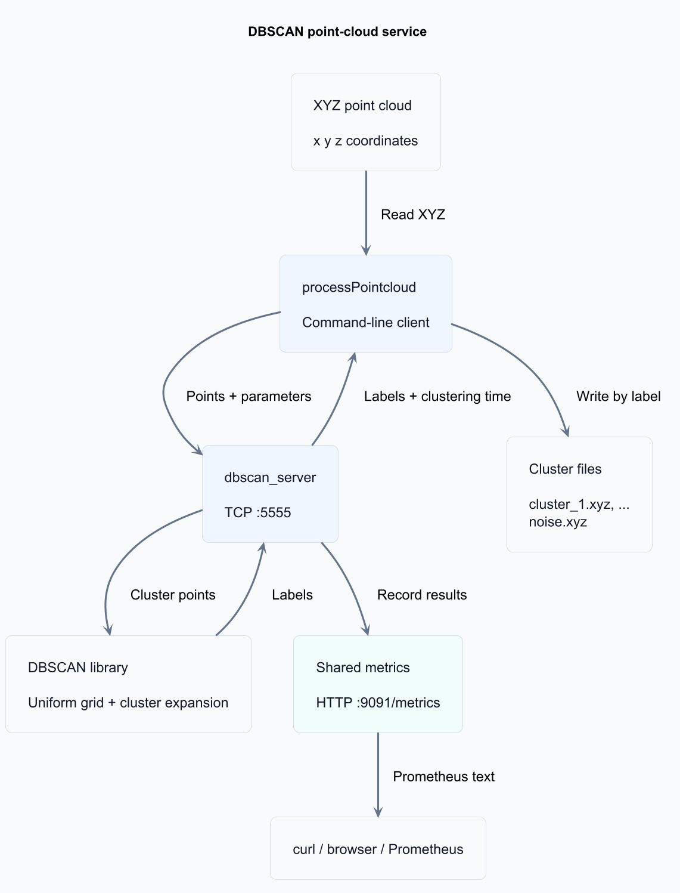

# DBSCAN Point-Cloud Service

**Turn a 3D point cloud into clusters and noise.**

A C++17 DBSCAN library with a TCP server, a command-line client, and built-in
Prometheus metrics. Send an XYZ file, choose a neighbourhood radius and minimum
point count, and get a separate file for every cluster.

[Quickstart](#quickstart) · [How it works](#how-it-works) ·
[Technical reference](docs/reference.md) · [Architecture](docs/design.md)

## What you get

- **Clustering without a preset cluster count.** DBSCAN groups points by density
  and labels isolated points as noise.
- **An embeddable C++ library.** Use the clustering algorithm directly, without
  starting a server or linking the networking layer.
- **A complete file-to-file workflow.** The client sends points over TCP and writes
  `cluster_1.xyz`, `cluster_2.xyz`, and `noise.xyz`.
- **Visibility into each workload.** Scrape request counts, errors, active
  connections, processed points, and clustering-duration histograms at `/metrics`.
- **Reproducible examples.** Included synthetic scenes, a naive reference
  implementation, automated checks, and an optional scikit-learn comparison help
  you inspect the results.

The clustering library uses the C++ standard library; the service adds POSIX
sockets. GoogleTest and scikit-learn are used only for testing and comparison.

## Quickstart

### 1. Build and test

Run the following in **Linux or Ubuntu WSL**, from the repository root. The TCP
service uses POSIX sockets and does not build directly in Windows PowerShell.

You need CMake **3.16+**, a **C++17 compiler** (GCC or Clang), Git, and internet
access for the first test configuration to fetch GoogleTest. Install Python 3 to
enable the end-to-end tests; `curl` is used for the metrics example below.

```sh
cmake -S . -B build
cmake --build build -j
(cd build && ctest --output-on-failure)
```

Release is the default for single-configuration generators. To build without
fetching GoogleTest, add `-DBUILD_TESTING=OFF` to the configuration command.

### 2. Start the server

In the same terminal, from the repository root:

```sh
./build/dbscan_server --port 5555 --metrics-port 9091
```

The server prints:

```text
DBSCAN on 5555, /metrics on 9091
```

### 3. Cluster the sample

Open a second Linux/WSL terminal in the repository root and run:

```sh
./build/processPointcloud \
  --input examples/data/spheres/sample_scene.xyz \
  --output-dir out_demo \
  --eps 0.65 \
  --min_samples 4 \
  127.0.0.1:5555
```

The included 1,000-point scene yields **three clusters of 300 points** and **100
noise points**. The client prints point and cluster counts plus the measured
clustering time, and writes:

```text
out_demo/
├── cluster_1.xyz     # 300 points
├── cluster_2.xyz     # 300 points
├── cluster_3.xyz     # 300 points
└── noise.xyz         # 100 points
```

Use a new or empty output directory for each run. Open the files in a point-cloud
viewer such as CloudCompare or MeshLab to inspect each cluster separately.

### 4. Inspect metrics

```sh
curl http://127.0.0.1:9091/metrics
```

The endpoint serves Prometheus text metrics; a separate Prometheus installation
is optional. Stop the server with **Ctrl+C**. Restart it after rebuilding to use
the updated binary.

## How it works



[PlantUML source](docs/assets/architecture.puml)

The grid uses cells of width `eps` and searches cells intersecting each point's
radius bounds, rounded outward to include floating-point boundary cases. It
filters candidates by distance. This reduces neighbour-search work for
spatially spread clouds; dense neighbourhoods can still require quadratic work.

| Setting or result | Meaning |
| --- | --- |
| `--eps` | Neighbourhood radius in metres; must be finite and positive |
| `--min_samples` | Minimum neighbours for a core point, including the point itself; at least 1 |
| Input | Whitespace-separated finite `x y z` coordinates, one point per line |
| Cluster labels | Positive integers in discovery order; `-1` means noise |
| Request limit | Up to 1,000,000 points per TCP request |

DBSCAN assigns spatial clusters. Ground removal, object classification, and
tracking are outside the service's scope.

## Use the library directly

Include `dbscan/dbscan.h` and link the CMake target `dbscan`:

```cpp
#include "dbscan/dbscan.h"

std::vector<dbscan::Point> points{
    {0, 0, 0}, {0.1F, 0, 0}, {10, 10, 10}
};
auto labels = dbscan::dbscan(points, 0.2F, 2); // {1, 1, -1}
```

Labels preserve input order. See the [library contract](docs/reference.md#library-contract)
for numeric bounds, validation, and lifetime requirements.

## Explore further

All commands below run from the repository root after building.

| Goal | Start here |
| --- | --- |
| Try the 5,000-point traffic scene | [Synthetic traffic scene](docs/reference.md#synthetic-traffic-scene) |
| Compare grid and naive clustering speed | Run `./build/benchmark_dbscan`; see [benchmark methodology](docs/reference.md#benchmark) |
| Check membership against scikit-learn | [Files and reference comparison](docs/reference.md#files-and-reference-comparison) |
| Write another client | [Binary wire protocol](docs/reference.md#wire-protocol) |
| Configure monitoring | [Metric names and scrape configuration](docs/reference.md#metrics) |
| Review architecture and tradeoffs | [Design document](docs/design.md) |
| Understand test coverage and the naive reference | [Test guide](tests/README.md) |

## Repository layout

The repository root is the CMake build entry point.

| Directory | Purpose |
| --- | --- |
| [`include/dbscan/`](include/dbscan/) | Public clustering headers |
| [`src/clustering/`](src/clustering/) | DBSCAN and uniform-grid implementation |
| [`src/service/`](src/service/) | Internal protocol, XYZ file I/O, and metrics headers and implementation |
| [`apps/`](apps/) | Server and command-line client entry points |
| [`tests/`](tests/) | Unit tests and end-to-end integration tests |
| [`benchmarks/`](benchmarks/) | Grid-versus-naive performance benchmark |
| [`tools/`](tools/) | Scene generators and optional scikit-learn comparison |
| [`fixtures/`](fixtures/) | Synthetic scene helpers shared by tests, tools, and benchmarks |
| [`examples/data/`](examples/data/) | Sphere and traffic scenes with ground truth |
| [`docs/`](docs/) | Architecture and technical reference |

## Deployment scope

This is a take-home implementation for trusted environments. Both listeners bind
all IPv4 interfaces, with no authentication or TLS. Connections use detached
threads without a global concurrency or memory budget, and shutdown does not
drain in-flight work. Socket timeouts do not limit clustering CPU time.

See [deployment limits and remaining production work](docs/reference.md#deployment-scope-and-remaining-production-work)
before deploying beyond a controlled environment.
