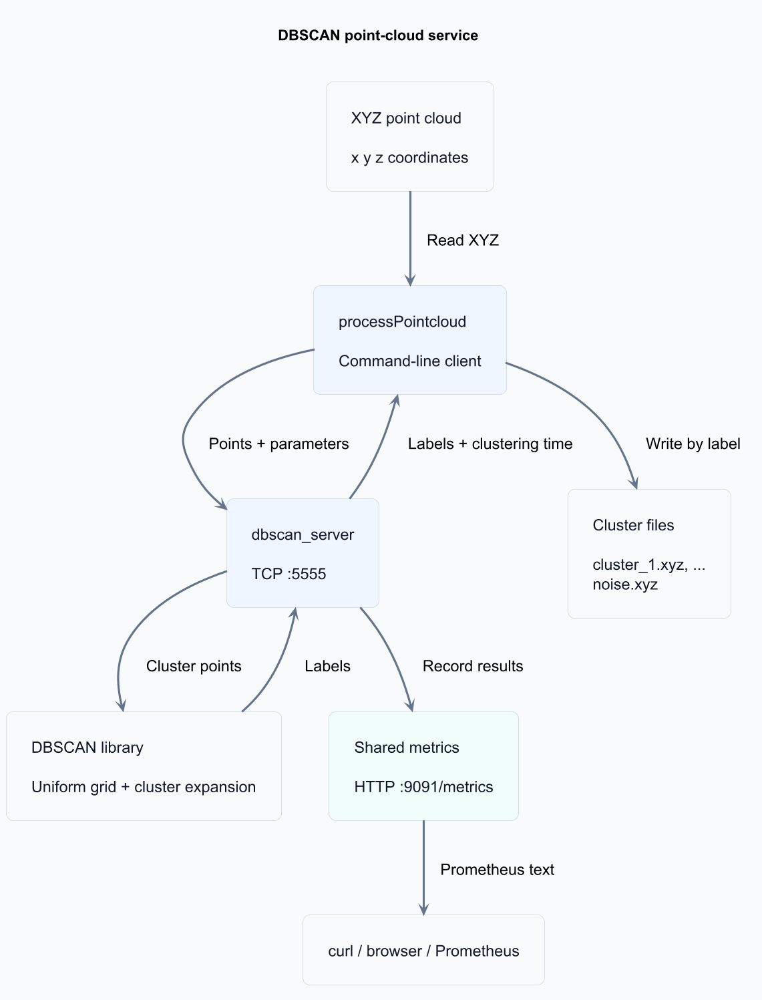

# DBSCAN service design

The service groups 3D points by spatial density and returns one label per input
point. Its target workload is about 5,000 points at 10 requests per second. The
design keeps clustering independent of networking and makes ownership explicit.
It assigns anonymous clusters; vehicle recognition, tracking and ground removal
are outside its scope. Build commands, wire offsets and metric names are in the
[technical reference](reference.md).

## Architecture



[PlantUML source](assets/architecture.puml). The PNG is rendered ahead of time,
so viewing this documentation does not require a diagram renderer or external
diagram service.

To regenerate it after editing the source, run this from the repository root
with Java and a local [PlantUML JAR](https://plantuml.com/download):

```sh
java -jar /path/to/plantuml.jar -charset UTF-8 -tpng docs/assets/architecture.puml
```

The source uses PlantUML's Smetana layout engine, so Graphviz is not required.

| Component | Responsibility |
| --- | --- |
| `dbscan` library | Point distances, grid construction and cluster expansion; no sockets or file I/O |
| `service_io` library | Wire encoding, socket helpers, XYZ files and metrics storage |
| Server | Accept connections, validate requests, time clustering and send results |
| Client | Parse options, read input, exchange data and partition output by label |
| Metrics listener | Serve a consistent snapshot independently of clustering handlers |

The server, client and tests link the clustering library. Only tests need
GoogleTest; sklearn is an optional independent reference tool.

## Source layout and build boundaries

The root `CMakeLists.txt` builds the project. Public clustering headers live in
`include/dbscan/`, with their implementation in `src/clustering/`. The `dbscan`
target has no dependency on the service layer.

`src/service/` keeps protocol, XYZ I/O, and metrics headers beside their
implementation. The `service_io` target exposes that internal include directory
to its consumers; these headers are separate from the public clustering API.
Server and client entry points live in `apps/server/` and `apps/client/`.

`tests/unit/` contains GoogleTest cases; `tests/integration/` contains Python
checks that launch the real binaries. `fixtures/synthetic.h` supplies shared
scene helpers to unit tests, scene-generation tools, and the benchmark, without
making tools depend on the test directory. `benchmarks/` contains performance
measurement; `tools/` contains generators and the optional reference comparison.

`examples/data/spheres/` and `examples/data/traffic/` keep each synthetic scene
with its ground truth and descriptive sidecars. Commands in the root README and
technical reference run from the repository root. Build outputs remain under
ignored `build/` or `build-*/` directories.

## Request lifecycle and ownership

1. The client reads finite XYZ coordinates, enforcing the one-million-point cap
   while reading. It validates parameters and requires a new or empty output directory.
2. It opens a TCP connection and sends a fixed header followed by coordinate triples.
3. The server copies the accepted descriptor into a detached handler thread. Passing
   a reference to the accept loop's local variable would be unsafe after that iteration.
4. The handler owns its request, points, grid, labels and response. It validates the
   header before allocating the declared payload, then invokes `dbscan()`.
5. The server sends the response header and labels. The client checks status, point
   count and label range before writing files. Coordinates remain unchanged.
6. The handler records its outcome and closes the connection. One connection serves
   one request; there is no persistent-session state.

`Socket` closes its descriptor on scope exit, including exception paths, and cannot
be copied. `release()` explicitly transfers descriptor ownership. The grid holds a
const reference to points: they must remain alive and unchanged while the grid is
used. The handler's local scopes provide that lifetime.

Only metrics are shared between handlers. A `shared_ptr` keeps them alive while
threads use them. One mutex protects updates and rendering, keeping histogram
buckets, count and sum consistent. Request buffers need no cross-thread locks.

## Clustering and spatial search

Labels follow input order: `0` is internal unvisited state, `-1` is noise, and
positive integers identify clusters in discovery order. A neighbourhood includes
the query point and the eps boundary. A point is core when its neighbourhood has
at least `minSamples` members.

Expansion uses a growing vector of seeds walked by index, since appending can
invalidate iterators. A queued flag prevents duplicate seed insertion. A previously
noisy point can become a border point, but is not expanded: it was already found
to be non-core. A border point touching two clusters belongs to the one that reaches
it first, so input order can affect that assignment.

Two entry points share expansion and differ only in neighbour search:

- `dbscanNaive()` scans all points per query. Its O(n²) work provides a simple
  reference for checking the index.
- `dbscan()` uses a uniform grid with cell size eps. Cell coordinates use
  `floor(coordinate / eps)`, including negatives. Each query scans the cells
  intersecting outward-rounded radius bounds, normally 27 cells, and filters
  candidates with `dist2 <= eps²`. The radius, coordinate bounds and cell-bound
  division are rounded outward with `nextafter`. This includes pairs such as
  `-1e-20` and `1` at eps=1: their double distance rounds to the radius even
  though their grid cells are two apart. Extra candidates still pass through
  the same distance predicate; the fix does not increase the accepted radius.

Three signed cell indices are offset by `2^20` and packed into non-overlapping
21-bit fields in a uint64 key. Out-of-range coordinates are rejected instead of
silently aliasing another cell. The supported index range is `[-2^20, 2^20 - 1]`
on each axis; supported spatial extent therefore depends on eps.

Coordinates and wire values are float32. Distance subtraction, squaring and eps²
use double intermediates to avoid float overflow/underflow. Boundary decisions
remain subject to floating-point rounding.

Both searches use O(n) auxiliary memory. The grid skips distant points efficiently
for spread-out scenes, but dense neighbourhoods still require O(n²) work. It is an
acceleration strategy, not a constant-time guarantee.

## Protocol and failure handling

The binary protocol uses a 20-byte request header and a 16-byte response header.
Point count determines payload length: three float32 coordinates per point in a
request and one int32 label per point in a successful response. The count and
fixed field sizes avoid needing a delimiter inside arbitrary binary data.

Fields are copied individually at fixed offsets, avoiding C++ struct padding and
unaligned typed accesses. The implementation requires little-endian hosts and
IEEE-754 float32. Detailed layouts and status values are in the
[wire protocol reference](reference.md#wire-protocol).

TCP is a byte stream. `readExact` and `writeExact` loop over partial transfers,
retry EINTR, and report failure on closure or other errors. Writes use MSG_NOSIGNAL
so a disconnected peer does not terminate the process.

| Failure | Behaviour |
| --- | --- |
| Complete invalid header | Return the corresponding error status, with no labels |
| Non-finite or out-of-grid-range coordinates | Return bad parameters |
| Truncated header or payload | Close the connection and count a failed request |
| Internal exception before response starts | Attempt an internal-error response |
| Failure after response starts | Close; never insert a second header into the label stream |
| Output file write failure | Client exits unsuccessfully; partial output may remain |

Service/client send and receive timeouts are 30 seconds per blocking operation.
They do not bound computation, DNS/connect duration or total request lifetime.
The separate metrics listener uses five-second socket timeouts, an 8 KiB header
cap and one request per HTTP connection. It handles scrapes serially.

## Timing and observability

`steady_clock` measures the complete `dbscan()` call, including grid construction,
but excludes file parsing, network transfer and output writing. The response reports
milliseconds; the Prometheus histogram stores seconds. Completed computations
contribute points and duration even if sending the response subsequently fails.
Rejected or truncated requests without a completed computation do not add durations.

Counters track completed handlers, failures and processed points. A gauge tracks
active clustering handlers; scrapes are excluded. Histogram buckets are cumulative,
including an infinity bucket, count and sum. Metrics reset on server restart; the
exporter does not persist time-series history. A separate Prometheus installation
is optional. See [metric definitions](reference.md#metrics).

## Validation and deployment tradeoffs

Hand-labelled tests check DBSCAN semantics; fixed-seed grid/naive comparisons check
spatial search. Because expansion is shared, agreement between those two searches
alone cannot establish expansion correctness. Ground truth and the optional sklearn
comparison provide additional checks. Integration tests exercise the actual binaries,
concurrent clients, partial/malformed messages, output membership and the exporter.

The reviewed code passed 37 CTest checks in both Release and ASan/UBSan builds.
The documented local Release benchmark measured approximately 4.6 ms for grid
clustering of 5,000 points and a separate TCP workload measured approximately
6.2 ms median round-trip time. These synthetic measurements are not qualification
for arbitrary clouds, real lidar accuracy or prolonged load.

The detached-thread model keeps the exercise small but has no process-wide
connection/memory budget. Dense workloads have no compute deadline or cancellation.
Shutdown does not drain requests, listeners bind all IPv4 interfaces, and neither
endpoint supplies authentication or TLS. Output directories are not published
transactionally. A production deployment needs explicit requirements and controls
for those limits; see [deployment scope](reference.md#deployment-scope-and-remaining-production-work).
